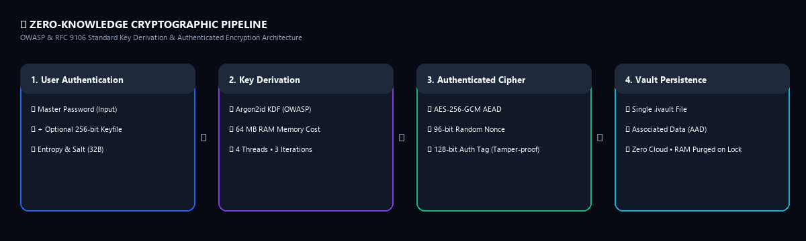

<div align="center">


# 🛡️ IronVault
### Military-Grade, Zero-Knowledge Offline Desktop Password Manager

[](https://www.python.org/)
[](https://en.wikipedia.org/wiki/Galois/Counter_Mode)
[-7C3AED?style=for-the-badge)](https://en.wikipedia.org/wiki/Argon2)
[](LICENSE)
[](README.md)

<p align="center">
  <b>IronVault</b> is a zero-knowledge, 100% offline desktop password manager built with maximum security and privacy at its core. Zero cloud dependencies, zero network requests, zero telemetry, and zero attack surface.
</p>

</div>

---

## 🖥️ Application Interface


IronVault features a sleek, dark-mode cyber aesthetic designed for speed, clarity, and ease of use:
- **Left Sidebar**: Instant filtering across categories (*Logins, Notes, Cards, API Keys, Favorites*) with quick action buttons.
- **Center Feed**: High-density credential cards showing icons, usernames, instant password copy, and live TOTP 2FA badges.
- **Right Inspector Panel**: Spacious form for adding and editing entries with integrated password generation, show/hide peek, URL launcher, and multi-line encrypted notes.

---

## 🔒 Cryptographic Architecture & Specifications



| Security Component | Standard / Algorithm | Parameters / Implementation Details |
|---|---|---|
| **Key Derivation Function (KDF)** | **Argon2id** (OWASP & RFC 9106) | • Time Cost: 3 iterations<br>• Memory Cost: 64 MB RAM (resistant to GPU/ASIC cracking)<br>• Parallelism: 4 threads<br>• Salt: 32 bytes (256-bit secure random) |
| **Authenticated Encryption** | **AES-256-GCM** (AEAD) | • Key: 256-bit derived symmetric key<br>• Nonce: 96-bit unique random per encryption<br>• Auth Tag: 128-bit authentication tag preventing tampering |
| **Tamper Resistance** | Header AAD Binding | Magic header (`IVLT`), format version, and salt are cryptographically bound to the ciphertext via Associated Authenticated Data. Any bit modification invalidates decryption. |
| **Dual-Factor Protection** | Master Password + Keyfile | Optional 256-bit cryptographically secure physical keyfile (e.g. on a USB drive). Both factors must be present to compute the master key. |
| **Memory Security** | In-Memory Zero-Knowledge Model | Sensitive data exists decrypted only within volatile RAM. Locking the vault or exiting immediately purges memory. |

---

## ✨ Key Features

- 🔐 **100% Offline & Air-Gapped**: Runs completely on your local machine. No external servers or internet required.
- ⏱️ **Built-in TOTP Authenticator (2FA)**: Full replacement for Google Authenticator/Authy. Generates 6-digit rolling codes with live progress indicators.
- 📋 **Secure Clipboard Auto-Clear**: Automatically wipes copied passwords and OTP codes from your system clipboard after 30 seconds.
- 🔒 **Inactivity Auto-Lock**: Automatically locks the vault and purges memory if left idle for 5 minutes.
- 🎲 **Cryptographic Password & Passphrase Generator**:
  - High-entropy random passwords (custom length, character sets, avoiding ambiguous characters).
  - Diceware multi-word passphrases (easy to memorize, mathematically hard to brute force).
- 📁 **Single-File Encrypted Portability**: Your vault is stored in a single `.ivault` file that can be easily backed up or transferred.

---

## 🚀 Getting Started

### Prerequisites
- Python 3.10 or higher
- Windows 10 / 11

### 1. Installation
Clone this repository and install the required dependencies:

```bash
git clone https://github.com/md1qamar/ironvault.git
cd ironvault
pip install -r requirements.txt
```

### 2. Launching the App
Run the launcher:
```bash
python main.py
```
*Or double-click `launch.bat` directly in Windows Explorer.*

### 3. Running Automated Tests
Verify cryptographic security and functional tests:
```bash
python test_ironvault.py
```

---

## 📁 Repository Structure

```
ironvault/
├── assets/                  # High-resolution screenshots and architecture diagrams
│   ├── hero_banner.png
│   ├── app_mockup.png
│   └── security_diagram.png
├── crypto.py                # Argon2id KDF, AES-256-GCM AEAD, and entropy analysis
├── vault.py                 # In-memory vault model, TOTP engine, password generator
├── security_manager.py      # Clipboard auto-clear and inactivity auto-lock watchdog
├── ui.py                    # CustomTkinter dark-mode desktop GUI
├── main.py                  # Executable entrypoint
├── test_ironvault.py        # Automated test suite
├── requirements.txt         # Project dependencies
├── launch.bat               # 1-click Windows runner
└── README.md                # Project documentation
```

---

## 📄 License
This project is open source and available under the [MIT License](LICENSE).
